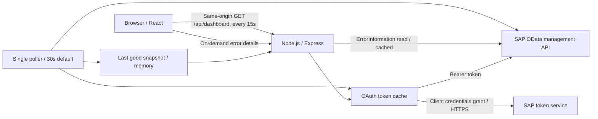

# SAP Cloud Integration monitoring dashboard

A runnable React + Node.js starter for SAP Integration Suite, Cloud Integration (often called CPI), targeting **Cloud Foundry**. Start in demo mode, then connect your tenant. This is a monitoring starter with in-memory snapshots, not a production observability platform. No SAP tenant or credentials were provided during development; live tenant behavior must be validated using the checks below.

## 1. Understand the architecture



The browser never receives the SAP client secret or access token. In development, Vite proxies `/api` to Express; after building, Express serves React and the API on the same origin. There is no permissive CORS configuration.

There are two distinct kinds of information:

| SAP resource | Dashboard behavior |
| --- | --- |
| `GET /api/v1/IntegrationRuntimeArtifacts` | Current deployed artifacts, name/ID, type, version, runtime status and `DeployedOn` |
| `GET /api/v1/MessageProcessingLogs` | Message GUID, interface name, status, `LogStart`, `LogEnd`, duration and correlation ID when present |
| `GET /api/v1/MessageProcessingLogs('{MessageGuid}')/ErrorInformation/$value` | Recorded error text, fetched only when an operator opens error details |

Deployment time is different from message execution time. `STARTED` describes a runtime artifact; `COMPLETED`, `FAILED`, `RETRY`, etc. describe messages. `COMPLETED` is evidence of CPI processing completion, not proof of business acceptance at a downstream system. Successful messages appear as log rows; this starter does not collect payloads, custom MPL attachments, trace steps or arbitrary application logs. Error information explains what SAP recorded, and is not an automatically diagnosed root cause.

## 2. Run the demonstration

Install Node.js **22.12 or later** (tested here with Node 24). Open a terminal in this folder:

```powershell
Copy-Item .env.example .env
npm.cmd ci
npm.cmd run dev
```

On macOS/Linux use `cp .env.example .env`, `npm ci` and `npm run dev`.

Open [http://127.0.0.1:5173](http://127.0.0.1:5173). Express runs at port 3001. Demo mode shows four synthetic interfaces and up to 48 messages with success, failure, retry and processing examples. The demo is clearly labeled in the UI. Use **View error** for a synthetic error report; try status, interface and text filters. Changes to `.env` require restarting the process.

To serve the built application with Node only:

```powershell
npm.cmd run build
npm.cmd start
```

Open [http://127.0.0.1:3001](http://127.0.0.1:3001). Stop the development servers before using the same backend port.

## 3. Provision SAP API access

These steps are for Cloud Foundry. Neo uses different client registration and token endpoints and is outside this implementation's setup scope.

1. In SAP BTP cockpit select the subaccount and Cloud Foundry space hosting Cloud Integration.
2. Create a **Process Integration Runtime** (`it-rt`) service instance with plan **`api`**. Select **Client Credentials** as the grant type.
3. Assign the **`MonitoringDataRead`** role template for monitoring access. Confirm the permissions of each resource in your tenant's current API documentation. Do not add deployment or administrative permissions to resolve an unexplained 403.
4. Create a service key with key type **ClientId/Secret**. Store it securely. The key supplies `clientid`, `clientsecret`, and `tokenurl` (field nesting can vary by key format).
5. Identify the **management host** where Cloud Integration's web UI/OData resources are available. Construct `https://<management-host>/api/v1/`. Do not use an integration flow's `/http/...` URL; do not blindly substitute the service key's runtime URL for the management host.
6. Verify the endpoints and response fields in SAP Business Accelerator Hub and, when available, your tenant's OData metadata. Some API resources support fewer query options than others; the starter deliberately avoids `$select`, `$orderby`, `$top` and `$skip` on runtime artifacts.

SAP references: [API client OAuth setup](https://help.sap.com/docs/integration-suite/sap-integration-suite/oauth-with-client-credentials-grant-for-api-clients), [message processing logs and permissions](https://help.sap.com/docs/cloud-integration/sap-cloud-integration/message-processing-logs), [Cloud Integration API catalog](https://api.sap.com/package/CloudIntegrationAPI), and [management versus runtime URL guidance](https://help.sap.com/docs/integration-suite/sap-integration-suite/first-steps-import-postman-collections).

## 4. Configure your environment

Edit the local `.env` file; never put credentials in frontend files or `VITE_*` variables:

```dotenv
DATA_MODE=sap
HOST=127.0.0.1
PORT=3001
SAP_API_BASE_URL=https://your-management-host/api/v1/
SAP_TOKEN_URL=https://your-auth-host/oauth/token
SAP_CLIENT_ID=your-service-key-clientid
SAP_CLIENT_SECRET=your-service-key-clientsecret
POLL_INTERVAL_MS=30000
LOOKBACK_HOURS=24
MAX_MESSAGES=1000
MAX_PAGES=20
REQUEST_TIMEOUT_MS=15000
ERROR_CACHE_MS=60000
AUTH_PROXY_CONFIRMED=false
```

| Variable | Meaning |
| --- | --- |
| `DATA_MODE` | `demo` (default) or `sap`; an SAP failure never silently switches to demo |
| `SAP_API_BASE_URL` | HTTPS management API root, including `/api/v1/` |
| `SAP_TOKEN_URL` | Exact `tokenurl` from the service key, without adding another `/oauth/token` |
| `SAP_CLIENT_ID`, `SAP_CLIENT_SECRET` | Server-side service key credentials |
| `POLL_INTERVAL_MS` | Backend SAP polling interval; minimum 10000, default 30000 |
| `LOOKBACK_HOURS` | Rolling message-start window in UTC; 1–168, default 24 |
| `MAX_MESSAGES` | Loaded message limit; 1–10000, default 1000 |
| `MAX_PAGES` | Maximum pages per SAP collection; 1–100, default 20 |
| `REQUEST_TIMEOUT_MS` | Timeout per outbound network request; default 15000 |
| `ERROR_CACHE_MS` | Error-text cache lifetime; default 60000; maximum 200 cached entries |
| `HOST`, `PORT` | Backend bind address and port; default `127.0.0.1:3001` |
| `AUTH_PROXY_CONFIRMED` | Explicit acknowledgment of an already configured authentication proxy for external binding; **does not implement or verify authentication** |

Restart with `npm.cmd run dev`, or build and run as in step 2. A fresh SAP snapshot replaces demo data only after you switch mode and restart.

## 5. How the backend works

Read these files in order:

1. `server/config.js`: validates mode, credentials, HTTPS URLs, bounds and external binding.
2. `server/sap.js`: exchanges client credentials for a token using HTTP Basic authentication and form data `grant_type=client_credentials`. Token requests are coalesced and tokens cached until shortly before expiry. API requests use `Authorization: Bearer ...`; a 401 clears the cached token and retries once.
3. `server/sap.js`, `snapshot()`: queries the deployed inventory and messages concurrently, requesting OData JSON. The message query is equivalent to:

```http
GET /api/v1/MessageProcessingLogs?$format=json&$filter=LogStart ge datetime'2026-10-24T00:00:00.000' and LogStart le datetime'2026-10-25T00:00:00.000'&$orderby=LogStart desc&$top=1001
Authorization: Bearer <server-only-token>
Accept: application/json
```

The actual request uses URL-encoded query parameters and a dynamically computed UTC window. SAP OData v2 JSON is normalized from `d.results`; `/Date(milliseconds)/` and ISO timestamps are converted to UTC ISO strings. Missing dates remain null; unfinished messages have no duration. Continuation links are followed within the configured management API root only. Redirects are rejected to avoid leaking credentials.

4. `server/poller.js`: one shared polling loop takes complete snapshots. It never overlaps its own refreshes, and backs off after failed refreshes with jitter, up to five minutes. A refresh is atomic: if either inventory or messages fail, the previous complete snapshot remains visible with a stale indicator. There is no process-global database or durable history.
5. `server/index.js`: serves sanitized API responses, health/readiness, rate limits and on-demand errors. Error IDs must belong to the loaded snapshot. Concurrent requests for one error share its cached promise; error text is capped at 20000 characters.

Application endpoints:

| Local endpoint | Response |
| --- | --- |
| `GET /api/dashboard` | Mode, polling interval, staleness, last attempt, safe error and last successful snapshot |
| `GET /api/messages/:id/error` | `{ "text": "..." }` for failed/retry/escalated messages in the snapshot |
| `GET /api/health` | 200 when fresh; 503 before first success or while stale; suitable as readiness, not a process liveness check |

Use `Invoke-RestMethod http://127.0.0.1:3001/api/dashboard` to inspect the normalized response. No local endpoint accepts an arbitrary SAP URL, filter or tenant credential.

## 6. How the frontend works

`src/main.jsx` reads `/api/dashboard` immediately, then every 15 seconds after each request completes. Effects abort requests and clear timers on cleanup. **Pause updates** pauses browser reads, while the shared backend continues collecting. Error details load on click and are canceled when selection changes. React renders SAP strings as text; there is no raw HTML injection.

`src/style.css` provides responsive cards and scrollable inventory/message tables. Status choices include observed SAP statuses rather than mapping every non-failure to success. Search matches interface, message GUID and correlation ID. Times display in the browser's local timezone; stored/query times are UTC.

## 7. Verify the integration

```powershell
npm.cmd test
npm.cmd run build
```

Automated tests use fake HTTP responses and exercise date normalization, OAuth coalescing, single 401 retry, continuation handling, cross-origin rejection, partial-result labeling, stale snapshots, and configuration safety. They do not prove your tenant's connectivity or permissions.

Live acceptance checklist:

1. Switch to SAP mode and check `/api/health` becomes ready after the first poll.
2. Compare inventory, runtime status and deployment time with **Monitor → Manage Integration Content** in SAP.
3. Compare a known completed message and a known failed message with SAP's message monitor in the same UTC window. Open the failed message's error details.
4. Test an interface with no recent executions: it should still appear in inventory.
5. Test empty results and high volume. The UI must show a partial-result warning when message/page caps are reached. Statistics are counts of **loaded rows**, not authoritative tenant-wide totals.
6. In a controlled environment interrupt SAP access. Confirm that the prior snapshot remains and stale status appears. Restore access and confirm refresh resumes.
7. Inspect browser network traffic: it should contain only your app requests and normalized data; no SAP token or client secret.

Troubleshooting:

| Symptom | Check |
| --- | --- |
| Token request fails / HTTP 401 | Exact token URL, credential validity, Client Credentials grant, API-plan key; rotate leaked or revoked secrets |
| SAP API HTTP 403 | API role templates on the service instance/key and tenant policies; inspect the particular resource's permissions |
| 404 or HTML instead of JSON | Management host and `/api/v1/` root; a runtime sender URL is not the management API |
| 400 message query | Supported query options/date format in your tenant's API specification; inspect tenant API metadata |
| Missing error details | SAP may not have recorded them, they may have expired, or your client may lack access |
| No old messages | SAP retention, selected start-time window, and configured caps |
| Frequent stale snapshots | Network latency, rate limits, credentials, SAP outages, or page volume; reduce lookback / increase interval |

The public UI intentionally returns generic upstream errors. For tenant troubleshooting, inspect status codes through a secure API client such as Postman using the same key, without adding token/secret/body dumps to application logs.

## 8. Security and production deployment

The included app has **no user login** and binds to localhost by default. Do not expose it publicly until user authentication and authorization are implemented or enforced at a trusted reverse proxy.

- Put the built app behind HTTPS and an enterprise identity provider (for example an SAP approuter/XSUAA or another OIDC gateway). Require an operator role for every UI/API route. Restrict direct backend access at the network layer. A proxy header alone is not authentication.
- For a remote container, set `HOST=0.0.0.0` and `AUTH_PROXY_CONFIRMED=true` only after that protection exists. This switch is an acknowledgment, not a security control. Do not use the Vite development server as a production host.
- Use a secret manager/platform service binding for production credentials; `.env` is local convenience. Never commit it, bundle it into frontend assets, include it in images, or attach service keys to tickets. Rotate secrets and verify revocation procedures.
- Grant only required SAP permissions; this implementation makes only read calls to management APIs. Restrict outbound destinations to your SAP management and token hosts; HTTPS and redirect validation are enabled. Do not disable TLS verification.
- Treat interface names, correlation IDs and error strings as potentially sensitive business data. Review/redact error text for your organization before broad access. The demo code does not implement domain-specific PII redaction. Error text is rendered safely but is not guaranteed to be free of secrets supplied by upstream systems.
- Security headers, no-store API responses, bounded inputs/caches and an in-process rate limit are included. Align proxy/IP handling before changing `trust proxy`; for multiple replicas use a shared rate-limit store and one coordinated collector.
- Do not add payload or trace collection by default. Define retention and access policies before persisting logs. SAP retention remains authoritative for this starter; memory resets on restart.
- Pin/retain `package-lock.json`, use `npm ci`, scan dependencies in CI, keep supported Node/dependencies patched, and audit access without logging credentials or full message bodies.

## 9. Extend beyond the starter

For large tenants, replace full-window snapshots with a scheduled collector and PostgreSQL. Upsert on `(tenant_id, MessageGuid)`, overlap collection windows to catch late records, periodically re-read in-progress/retry messages, and use checkpoints plus reconciliation so a new-start watermark does not miss status changes. Inventory should have its own refresh schedule. Persist deployment observations if you need history: the runtime inventory only exposes current deployed artifacts, not a complete deployment audit trail or a list of every design-time flow.

Add database pagination and tenant-wide aggregates, alert deduplication, retention jobs, auditing, multi-tenant authorization and deployment automation. Avoid multiplying SAP polling by the number of browser users or application replicas. Validate tenant limits before lowering polling intervals. An interface absent from runtime inventory is not automatically proof of a failed deployment; inspect design-time/deployment APIs and SAP monitoring separately.

## Project map

```text
cpi-dashboard/
  .env.example
  package.json / package-lock.json
  index.html / vite.config.js
  server/
    config.js       Environment validation
    sap.js          OAuth, SAP API and data normalization
    demo.js         Synthetic inventory and messages
    poller.js       Shared snapshots, backoff and stale state
    index.js        Express routes and built frontend hosting
    sap.test.js     Meaningful backend tests
  src/
    main.jsx        React dashboard, filters and polling
    style.css       Responsive UI
```
